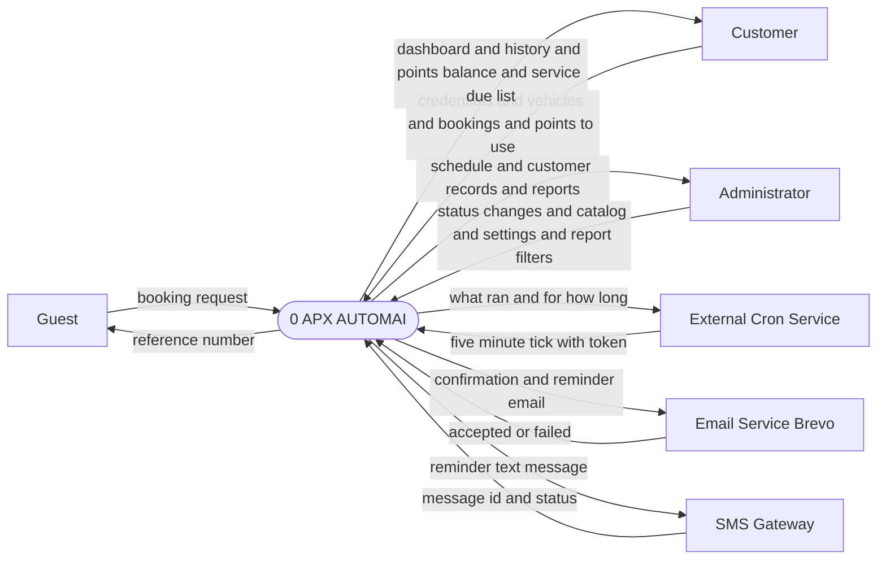
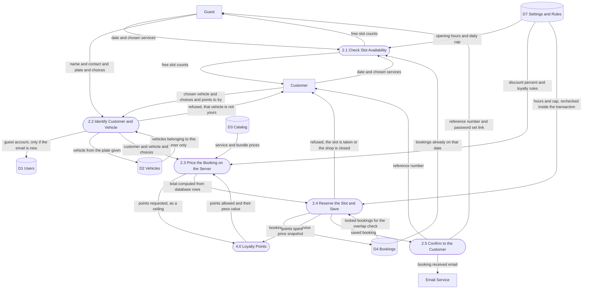
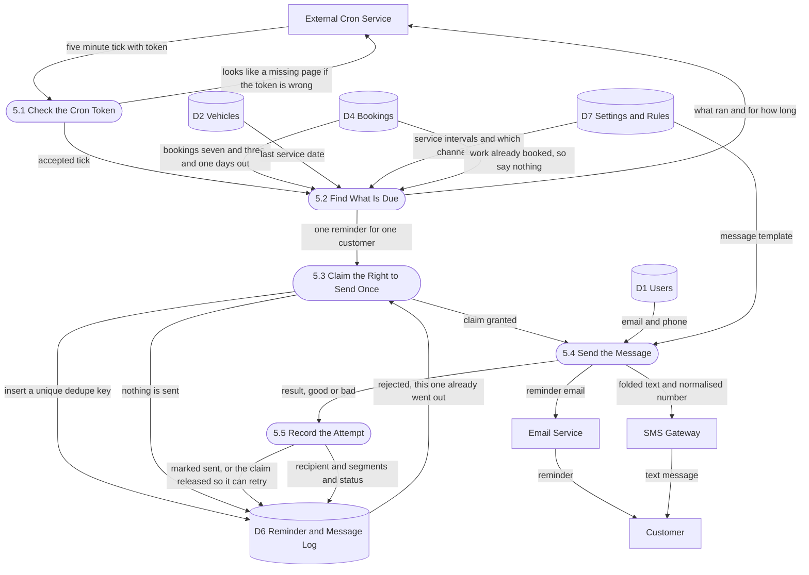

# APX AUTOMAI — ERD and Data Flow Diagrams

System diagrams for the APX Motors Service Center booking system, for the
capstone paper and the defense.

Every diagram below is Mermaid source. The blocks are **byte-identical to the
`.mmd` files** beside this document, which are the canonical copies — this file
is the readable companion, not a second version to keep in sync by hand. Lines
beginning `%%` are comments and do not appear in the rendered diagram, so a
block can be pasted into Excalidraw, GitHub, VS Code or Mermaid Live as it is.

Two sets of DFDs exist. **This document carries the simplified set**, the one
to present. The detailed set — nine processes, twelve datastores, prose arrow
labels and a class-and-method map on every flow — lives in the sibling `.mmd`
files for the appendix and for answering "where is that in the code?".

- [How to read these](#how-to-read-these)
- [Entity Relationship Diagram](#entity-relationship-diagram)
- [Level 0 — Context](#level-0--context)
- [Level 1 — The six subsystems](#level-1--the-six-subsystems)
- [Level 2 — Booking and pricing](#level-2--booking-and-pricing)
- [Level 2 — Scheduled reminders](#level-2--scheduled-reminders)
- [Three decisions worth defending](#three-decisions-worth-defending)

---

## How to read these

| Shape | Means |
| --- | --- |
| Rounded / stadium | A **process** — something the system does |
| Rectangle | An **external entity** — someone or something outside the system |
| Cylinder | A **datastore** — one or more database tables |
| Arrow | **Data moving.** Every arrow is labelled with what travels on it |
| Double-headed arrow | The process both reads from and writes to that store |

Processes are numbered so a level traces to its parent: `2.0` on Level 1
decomposes into `2.1`–`2.5` on its Level 2 diagram.

### Datastores used by these diagrams

| | Tables |
| --- | --- |
| D1 Users | `users`, `customers` |
| D2 Vehicles | `vehicles` |
| D3 Catalog | `services`, `bundles`, `bundle_service`, `mechanics` |
| D4 Bookings | `bookings`, `booking_service`, `booking_reschedule_requests` |
| D5 Loyalty Ledger | `loyalty_ledger` |
| D6 Reminder and Message Log | `reminders`, `sms_logs` |
| D7 Settings and Rules | `settings`, `maintenance_rules` |
| D8 Audit and Deletions | `audit_logs`, `account_deletions` |

The detailed DFD set numbers these `D1`–`D12` instead, splitting each group.
**Quote one scheme or the other in the paper, never both** — the crosswalk is
in `README.md`.

### Scope

Roles are **`admin` and `customer`, and that is all.** Mechanics are records
with a name and a contact number, not accounts; there is no mechanic login and
no staff portal. Loyalty has **no tiers** — a balance is derived from a ledger.

`payments`, `notification_logs`, `rewards` and the old `employees` table exist
in the schema as migration leftovers that nothing reads or writes. They are
deliberately absent from every diagram, as are Laravel's framework tables
(`sessions`, `password_reset_tokens`, `cache`, `jobs`, `notifications`).

---

## Entity Relationship Diagram

Seventeen entities. Derived from the **live schema** rather than the migration
files alone — read back with `PRAGMA table_info`, `index_list` and
`foreign_key_list`, so columns that later migrations added and columns they
dropped are both accounted for.

### Entity glossary

| Entity | What it holds |
| --- | --- |
| `users` | Every account. `role` is `admin` or `customer`; `is_guest` marks a record the shop created for a walk-in |
| `customers` | Optional profile details hanging off a user — address and date of birth |
| `vehicles` | A customer's cars and motorcycles. `last_service_date` is what maintenance reminders count from |
| `services` | The catalog of individual jobs, with price and duration |
| `bundles` | Several services sold together for less, optionally time-limited |
| `bundle_service` | Which services a bundle contains |
| `mechanics` | Names and contact numbers so work can be assigned. Not accounts |
| `bookings` | One appointment, with its status and its price record |
| `booking_service` | The priced line items of a booking. **Carries the snapshotted price** |
| `loyalty_ledger` | Every point movement as a signed row. The balance is their sum |
| `maintenance_rules` | What counts as "due for servicing" — an interval in months and how far ahead to warn |
| `reminders` | The claim that makes each reminder send exactly once |
| `sms_logs` | Every text attempt and its outcome, successful or not |
| `settings` | Key/value configuration, message template bodies included |
| `audit_logs` | Who changed what, from what, and why |
| `account_deletions` | A deletion request and its 30-day grace period |
| `booking_reschedule_requests` | A proposed schedule change, pending until resolved |

### Notes on the schema, for questions you may get

- **`bookings.service_id` still exists, is `NOT NULL`, and is not dead.**
  `BookingAvailability::reserve` sets it to the first chosen service. It
  predates the `booking_service` pivot and is kept as a primary-service anchor.
- **`maintenance_rules.interval_months` is nullable.** A rule without one has
  nothing to count from and is skipped rather than firing on a null date.
- **`account_deletions.user_id` is indexed but has no foreign key constraint.**
- **`mechanics.name` is not unique.** Two mechanics may share a name.
- **`customers` and `account_deletions` have no unique index on `user_id`**, so
  the schema permits many per user even though the code only ever writes one.
  The diagram shows one-to-many to match the schema, not the convention.
- Soft deletes (`deleted_at`) are on `users`, `vehicles`, `services`,
  `bundles` and `bookings`.

```mermaid
%% APX AUTOMAI - Entity Relationship Diagram
%% -
%% Derived from the live schema, not from the migration files alone: read back
%% with PRAGMA table_info, index_list and foreign_key_list against
%% database/database.sqlite, so columns added by later migrations and columns
%% dropped by them are both accounted for.
%% -
%% Supersedes the earlier version of this file. What it had wrong:
%%   - bookings.service_id was missing entirely. It still exists, is NOT NULL,
%%     and carries a foreign key to services. BookingAvailability::reserve sets
%%     it to the first chosen service, so it is a live legacy anchor rather
%%     than a dead column, and leaving it out hid a real relationship.
%%   - mechanics.name was marked UK. There is no unique index on it.
%%   - maintenance_rules.interval_months was described as required. It is
%%     nullable, and MaintenanceDue skips a rule that has none.
%%   - booking_reschedule_requests was absent.
%%   - vehicles.year and color and mileage_updated_at, services and bundles
%%     soft deletes, reminders.status and error, sms_logs.content and
%%     reference_id and fail_reason and vehicle_id, audit_logs.auditable_type
%%     and auditable_id and subject, and the account_deletions counters were
%%     all absent.
%%   - account_deletions.user_id was shown as a foreign key. It is indexed
%%     only, with no constraint.
%% -
%% Excluded on purpose, per CLAUDE.md: payments, notification_logs, rewards and
%% the old employees table. Also excluded: Laravel framework tables - sessions,
%% password_reset_tokens, cache, cache_locks, jobs, job_batches, failed_jobs,
%% notifications, migrations.
%% -
%% Excalidraw note: erDiagram imports as a single image rather than editable
%% shapes. erd-flowchart.mmd carries the same relationships in flowchart
%% syntax for when you need to move boxes around.

erDiagram
    USERS ||--o{ CUSTOMERS : "has a profile row, one by convention and not enforced"
    USERS ||--o{ VEHICLES : "owns"
    USERS ||--o{ BOOKINGS : "places"
    USERS ||--o{ BOOKINGS : "cancelled"
    USERS ||--o{ LOYALTY_LEDGER : "earns and spends"
    USERS ||--o{ AUDIT_LOGS : "acted in"
    USERS ||--o{ REMINDERS : "receives"
    USERS ||--o{ ACCOUNT_DELETIONS : "requested, indexed with no constraint"
    USERS ||--o{ BOOKING_RESCHEDULE_REQUESTS : "proposed"
    USERS ||--o{ BOOKING_RESCHEDULE_REQUESTS : "resolved"

    VEHICLES ||--o{ BOOKINGS : "is serviced in"
    VEHICLES ||--o{ REMINDERS : "is due for"
    VEHICLES ||--o{ SMS_LOGS : "is the subject of"

    SERVICES ||--o{ BOOKINGS : "is the legacy primary service of"
    SERVICES ||--o{ BOOKING_SERVICE : "is priced in"
    SERVICES ||--o{ BUNDLE_SERVICE : "is part of"
    SERVICES ||--o{ MAINTENANCE_RULES : "is recommended by"

    BUNDLES ||--o{ BOOKINGS : "was sold under"
    BUNDLES ||--o{ BUNDLE_SERVICE : "includes"
    BUNDLES ||--o{ MAINTENANCE_RULES : "is recommended by"

    MECHANICS ||--o{ BOOKINGS : "is assigned to"

    BOOKINGS ||--o{ BOOKING_SERVICE : "is itemised by"
    BOOKINGS ||--o{ LOYALTY_LEDGER : "moves points through"
    BOOKINGS ||--o{ SMS_LOGS : "triggered"
    BOOKINGS ||--o{ REMINDERS : "is reminded of"
    BOOKINGS ||--o{ BOOKING_RESCHEDULE_REQUESTS : "is proposed to move by"

    MAINTENANCE_RULES ||--o{ REMINDERS : "raises"

    USERS {
        int id PK
        string name
        string email UK
        string phone "nullable, the number SMS goes to"
        string role "admin or customer only"
        datetime email_verified_at "nullable"
        string password "hashed"
        boolean is_active "disable without deleting"
        boolean is_guest "a record the shop made for a walk-in"
        string remember_token "nullable"
        datetime deleted_at "soft delete"
        datetime created_at
        datetime updated_at
    }

    CUSTOMERS {
        int id PK
        int user_id FK "cascade on delete, no unique index"
        string phone "nullable"
        date dob "nullable"
        string address "nullable"
        datetime created_at
        datetime updated_at
    }

    VEHICLES {
        int id PK
        int user_id FK "cascade on delete"
        string make
        string model
        int year "nullable"
        string plate_number UK
        string color "nullable"
        boolean is_primary
        string vehicle_type "car or motorcycle"
        date last_service_date "nullable, maintained by ServiceHistory on completion"
        int mileage "nullable, the shop reads it and nothing decides from it"
        date mileage_updated_at "nullable"
        datetime deleted_at "soft delete"
        datetime created_at
        datetime updated_at
    }

    SERVICES {
        int id PK
        string name
        text description "nullable"
        decimal price "10 comma 2"
        int duration "minutes"
        string category "nullable"
        boolean is_active
        string vehicle_type "nullable means it suits any"
        datetime deleted_at "soft delete"
        datetime created_at
        datetime updated_at
    }

    BUNDLES {
        int id PK
        string name UK
        text description "nullable"
        decimal price "10 comma 2"
        boolean is_active
        date starts_at "nullable"
        date ends_at "nullable"
        string vehicle_type "nullable means it suits any"
        datetime deleted_at "soft delete"
        datetime created_at
        datetime updated_at
    }

    BUNDLE_SERVICE {
        int id PK
        int bundle_id FK "cascade on delete"
        int service_id FK "cascade on delete"
        datetime created_at
        datetime updated_at
    }

    MECHANICS {
        int id PK
        string name "no unique index"
        string specialty "nullable"
        string status "active or inactive"
        string contact_number "nullable"
        datetime created_at
        datetime updated_at
    }

    BOOKINGS {
        int id PK
        int user_id FK "cascade on delete"
        int vehicle_id FK "cascade on delete"
        int service_id FK "NOT NULL legacy primary service, set to the first chosen one"
        int mechanic_id FK "nullable, set null on delete"
        int bundle_id FK "nullable, set null on delete"
        string reference_number UK
        date booking_date
        time booking_time
        int duration "nullable, minutes, summed from the chosen services"
        string status "pending confirmed in_progress completed cancelled"
        text notes "nullable"
        datetime arrived_at "nullable"
        string cancel_reason "nullable"
        int cancelled_by FK "nullable, null also means the system cancelled it"
        datetime cancelled_at "nullable"
        decimal bundle_price "nullable snapshot"
        decimal list_price "nullable snapshot before any discount"
        int discount_percent "snapshot"
        decimal discount_amount "snapshot"
        int points_earned "snapshot"
        int points_spent "snapshot"
        decimal points_discount "snapshot"
        datetime deleted_at "soft delete"
        datetime created_at
        datetime updated_at
    }

    BOOKING_SERVICE {
        int id PK
        int booking_id FK "cascade on delete, unique with service_id"
        int service_id FK "cascade on delete, unique with booking_id"
        decimal price "snapshot with the discount already allocated into it"
        int duration "snapshot in minutes"
        datetime created_at
        datetime updated_at
    }

    LOYALTY_LEDGER {
        int id PK
        int user_id FK "cascade on delete"
        int booking_id FK "nullable, unique with reason, null on adjustments and expiries"
        int points "signed, positive earns and negative spends"
        int remaining "nullable, the unspent part of an earn lot"
        int balance_after "so drift against the sum is detectable"
        string reason "earned redeemed reversed refunded expired adjusted"
        string note "nullable"
        date expires_at "nullable, set on earn rows only"
        datetime created_at
        datetime updated_at
    }

    MAINTENANCE_RULES {
        int id PK
        string name
        string description "nullable"
        int bundle_id FK "nullable, what to recommend booking"
        int service_id FK "nullable, what to recommend booking"
        int interval_months "nullable, and a rule with none is skipped"
        int lead_days "how far ahead of the due date to warn"
        string vehicle_type "nullable applies to all"
        boolean is_active
        int sort_order
        datetime created_at
        datetime updated_at
    }

    REMINDERS {
        int id PK
        string type "appointment or maintenance"
        int user_id FK "cascade on delete"
        int vehicle_id FK "nullable, set null on delete"
        int booking_id FK "nullable, cascade on delete"
        int maintenance_rule_id FK "nullable, set null on delete"
        string trigger_key "remind_7d remind_3d remind_1d remind_2h maintenance_due"
        string channel "email or sms"
        date due_date "nullable"
        string status "claimed then sent"
        text error "nullable"
        datetime sent_at "nullable"
        string dedupe_key UK "the claim that makes a send exactly once"
        datetime created_at
        datetime updated_at
    }

    SMS_LOGS {
        int id PK
        int booking_id FK "nullable, set null on delete"
        int vehicle_id FK "nullable, set null on delete"
        string recipient "nullable, normalised to E164"
        text content "what was actually sent, after GSM7 folding"
        int segments "counted after folding"
        string status "sent or failed or skipped"
        string reference_id "nullable, the provider message id"
        text fail_reason "nullable"
        string trigger "nullable"
        datetime created_at
        datetime updated_at
    }

    AUDIT_LOGS {
        int id PK
        int user_id FK "nullable, set null on delete"
        string actor_name "nullable, kept so the trail survives the account"
        string action
        string auditable_type "nullable, polymorphic subject class"
        int auditable_id "nullable, polymorphic subject id"
        string subject "nullable, a human label such as a reference number"
        text old_values "nullable, JSON encoded"
        text new_values "nullable, JSON encoded"
        text reason "nullable"
        datetime created_at
        datetime updated_at
    }

    ACCOUNT_DELETIONS {
        int id PK
        int user_id "indexed only, no foreign key constraint"
        int bookings_cancelled
        int bookings_retained
        int vehicles_anonymized
        datetime purge_at "nullable, thirty days after the request"
        datetime anonymized_at "nullable"
        datetime restored_at "nullable"
        datetime created_at
        datetime updated_at
    }

    BOOKING_RESCHEDULE_REQUESTS {
        int id PK
        int booking_id FK "cascade on delete"
        date proposed_date
        time proposed_time
        date original_date
        time original_time
        text reason
        string status "pending applied withdrawn"
        int proposed_by FK "nullable, set null on delete"
        int resolved_by FK "nullable, set null on delete"
        datetime resolved_at "nullable"
        datetime created_at
        datetime updated_at
    }

    SETTINGS {
        int id PK
        string key UK
        text value "nullable, message template bodies live here too"
        datetime created_at
        datetime updated_at
    }
```

> `erDiagram` imports into Excalidraw as a single image rather than editable
> shapes. `erd-flowchart.mmd` carries the same entities and relationships in
> flowchart syntax when you need to move boxes around.

---

## Level 0 — Context

The whole system as one process, with everything outside it.

**Say it in sixty seconds.** Four kinds of actor touch the system and two
outside services carry messages for it. A guest can book without an account. A
customer manages vehicles and bookings. An admin runs the shop. And because the
free hosting tier has no cron, no worker and no shell, an outside clock has to
knock on the door every five minutes for anything scheduled to happen at all.

By convention a Level 0 diagram carries no datastore — the system is a single
box, so its internal storage is not yet visible.

---

## Level 1 — The six subsystems

**Say it in sixty seconds**, one line per process:

| | |
| --- | --- |
| **1.0 Accounts and Access** | Proves who you are, and closes accounts down when asked |
| **2.0 Booking and Scheduling** | Takes a booking, checks the slot is free, and prices it on the server |
| **3.0 Booking Operations** | The shop moving that booking through to done or cancelled |
| **4.0 Loyalty Points** | Points, kept as a ledger so a balance can always be explained |
| **5.0 Reminders and Notifications** | The only part nobody clicks. A clock drives it |
| **6.0 Administration and Reports** | The shop setting its own prices, hours and rules, and reading back what happened |

Three merges compress the nine processes of the detailed diagram into six, and
each is defensible on its own terms:

| Detailed | Here | Why |
| --- | --- | --- |
| intake + pricing | **2.0** | A customer never prices a booking as a separate act; it happens inside one submission |
| maintenance detection + dispatch | **5.0** | Detection only ever runs to feed a reminder, or the dashboard panel that mirrors it |
| catalog/settings + reporting | **6.0** | Both are the admin reading and writing configuration and figures |

Nothing was dropped to get to six. Accounts, booking operations and loyalty all
survive intact.

```mermaid
%% APX AUTOMAI - Level 1 Data Flow Diagram (defense version)
%% -
%% dfd-level1.mmd has 9 processes, 12 datastores and 85 arrows carrying full
%% sentences. It is right, and it is unexplainable in ten minutes. This is the
%% same system at the altitude a panel can follow: 6 processes, 8 datastores,
%% and every arrow a data name rather than a sentence.
%% -
%% What was merged, and why it is honest:
%%   - pricing folded into 2.0, because a customer never prices a booking as a
%%     separate act; it happens inside one submission
%%   - maintenance due detection folded into 5.0, because it only ever runs to
%%     feed a reminder or the dashboard panel that mirrors it
%%   - reporting folded into 6.0 with catalog and settings, because both are
%%     the admin reading and writing configuration and figures
%% -
%% Legend: stadium = process, rectangle = external entity, cylinder = datastore.
%% A double headed arrow means the process both reads and writes that store.
%% -
%% Datastore grouping. The detailed diagram numbers these D1 to D12; see
%% README.md for the crosswalk before you quote a D-number in the paper.
%%   D1 users and customers
%%   D2 vehicles
%%   D3 services and bundles and mechanics
%%   D4 bookings and booking_service and booking_reschedule_requests
%%   D5 loyalty_ledger
%%   D6 reminders and sms_logs
%%   D7 settings and maintenance_rules
%%   D8 audit_logs and account_deletions
%% -
%% Sixty second narration, one line per process:
%%   1.0 proves who you are and closes accounts down when asked.
%%   2.0 takes a booking, checks the slot is free and prices it on the server.
%%   3.0 is the shop moving that booking through to done or cancelled.
%%   4.0 is points, kept as a ledger so a balance can always be explained.
%%   5.0 is the only part nobody clicks; a clock drives it.
%%   6.0 is the shop setting its own prices, hours and rules, and reading back
%%       what happened.
%% -
%% Process to code map:
%%   1.0  routes/auth.php, RegisteredUserController, RoleMiddleware, AccountAnonymizer
%%   2.0  GuestBookingController, Customer\DashboardController::store,
%%        AvailabilityController, BookingAvailability, BookingPricing
%%   3.0  Admin\BookingController, BookingCancellation, ServiceHistory
%%   4.0  LoyaltyService
%%   5.0  SendBookingReminders, SendMaintenanceReminders, MaintenanceDue,
%%        ReminderLedger, SmsService
%%   6.0  Admin\SettingsController, BundleController, MaintenanceRuleController,
%%        MechanicController, MessageTemplateController, ReportController

flowchart TD
    GUEST["Guest"]
    CUST["Customer"]
    ADMIN["Administrator"]
    CRON["External Cron Service"]
    MAIL["Email Service"]
    SMSGW["SMS Gateway"]

    P1(["1.0 Accounts and Access"])
    P2(["2.0 Booking and Scheduling"])
    P3(["3.0 Booking Operations"])
    P4(["4.0 Loyalty Points"])
    P5(["5.0 Reminders and Notifications"])
    P6(["6.0 Administration and Reports"])

    D1[("D1 Users")]
    D2[("D2 Vehicles")]
    D3[("D3 Catalog")]
    D4[("D4 Bookings")]
    D5[("D5 Loyalty Ledger")]
    D6[("D6 Reminder and Message Log")]
    D7[("D7 Settings and Rules")]
    D8[("D8 Audit and Deletions")]

    %% 1.0 Accounts and access
    CUST -->|"credentials"| P1
    ADMIN -->|"credentials"| P1
    P1 <-->|"account record and role"| D1
    P1 -->|"session"| CUST
    P1 -->|"session"| ADMIN
    P1 -->|"reset and verify links"| MAIL
    CUST -->|"deletion request"| P1
    P1 <-->|"grace period record"| D8
    P1 -->|"details scrubbed after the grace period"| D2
    CRON -->|"account purge tick"| P1

    %% 2.0 Booking and scheduling
    GUEST -->|"contact details and plate and booking request"| P2
    CUST -->|"booking request and points to use"| P2
    D3 -->|"prices and durations"| P2
    D7 -->|"opening hours and capacity and discount rules"| P2
    D2 -->|"the customer own vehicle"| P2
    P2 -->|"guest account"| D1
    P2 -->|"vehicle from the plate given"| D2
    P2 <-->|"booking and price snapshot"| D4
    P2 -->|"points to redeem"| P4
    P4 -->|"points allowed"| P2
    P2 -->|"free slot counts and reference number"| GUEST
    P2 -->|"free slot counts and reference number"| CUST
    P2 -->|"booking received email"| MAIL

    %% 3.0 Booking operations
    ADMIN -->|"status change and mechanic and cancellation reason and proposed new date"| P3
    CUST -->|"own cancellation"| P3
    P3 <-->|"booking and reschedule proposal"| D4
    D3 -->|"available mechanics"| P3
    P3 -->|"last service date"| D2
    P3 -->|"award or reverse points"| P4
    P3 -->|"who changed what and why"| D8
    P3 -->|"status change email"| MAIL
    P3 -->|"updated booking"| CUST
    CRON -->|"no show tick"| P3

    %% 4.0 Loyalty points
    D7 -->|"loyalty rules"| P4
    P4 <-->|"points ledger"| D5
    ADMIN -->|"manual adjustment with a reason"| P4
    P4 -->|"balance and history"| CUST
    P4 -->|"adjustment record"| D8
    CRON -->|"point expiry tick"| P4

    %% 5.0 Reminders and notifications
    CRON -->|"reminder tick"| P5
    D4 -->|"bookings due soon"| P5
    D2 -->|"last service date"| P5
    D7 -->|"service intervals and message templates"| P5
    D1 -->|"email and phone"| P5
    P5 <-->|"exactly once claim and delivery record"| D6
    P5 -->|"reminder email"| MAIL
    P5 -->|"reminder text message"| SMSGW
    P5 -->|"service due list"| CUST

    %% 6.0 Administration and reports
    ADMIN -->|"catalog and hours and prices and rules and report filters"| P6
    P6 -->|"services and bundles and mechanics"| D3
    P6 -->|"settings and rules and templates"| D7
    P6 -->|"what was changed"| D8
    D4 -->|"completed work and revenue"| P6
    D5 -->|"points liability"| P6
    D6 -->|"what was actually sent"| P6
    P6 -->|"figures and charts and exports"| ADMIN
```

---

## Level 2 — Booking and pricing

Decomposition of **2.0**. This is the diagram that answers *"what stops someone
editing the price in the browser and booking a major service for one peso?"*

**Follow the arrows leaving the browser.** They carry **choices** — which
services, which vehicle, which date, how many points to try to use. Not one of
them carries a price, a discount or a total. Process 2.3 reads every figure
from the catalog and the settings instead, and 2.4 writes the result into the
booking as a **snapshot**, so a price the shop changes next month cannot
rewrite what a past booking cost.

**Say it in sixty seconds.**

| | |
| --- | --- |
| **2.1** | Answers "is that slot free" before the customer commits to anything |
| **2.2** | Where the two paths meet — a guest gets an account made for them; a signed-in customer picks a vehicle we check they actually own |
| **2.3** | Prices the work on the server, from the database |
| **2.4** | Saves it inside one transaction, so two people cannot take the same slot by submitting at the same moment |
| **2.5** | Tells the customer the reference number |

---

## Level 2 — Scheduled reminders

Decomposition of **5.0**. This is the diagram that answers *"if the clock knocks
every five minutes and a reminder window is a whole date, why doesn't the
customer get the same text 1,440 times a day?"*

The answer is **process 5.3**, and it is drawn on the path rather than implied.
Nothing is sent until a claim is **inserted** against a unique key, so the
database decides who wins and two overlapping ticks cannot both pass it. On a
failure the claim is **deleted** rather than flagged, so one dead SMTP
connection does not cancel the reminder for good.

**Say it in sixty seconds.**

| | |
| --- | --- |
| **5.1** | Checks the shared secret. A wrong or missing token looks like a page that does not exist, so a leaked URL is not an open door |
| **5.2** | Asks what is due — appointments coming up, and vehicles past their service interval that have no work already booked |
| **5.3** | Claims the right to send, exactly once |
| **5.4** | Sends it, by email or text or both |
| **5.5** | Writes down what happened either way, because the question afterwards is always "did the customer actually get it?" |

---

## Three decisions worth defending

If the panel asks "why is it built that way?", these are the three answers the
diagrams are drawn to support.

**1. The price is snapshotted, not looked up.**
`booking_service.price` stores what each line cost **at the time of booking**,
with the discount already allocated into it. The alternative — joining to
`services.price` whenever a booking is displayed — means the shop correcting a
price next month silently rewrites the revenue figures for every booking in
history. Shown on the Level 2 booking diagram as the arrow from 2.4 into D4.

**2. Points are a ledger, not a column.**
A single `loyalty_points` balance on the customer is a number with no history:
when it eventually disagrees with reality there is nothing to reconstruct it
from. `loyalty_ledger` stores every movement as a signed row, and the balance
is their sum. Earn rows double as lots, consumed oldest-first, which is what
makes expiry possible at all. A unique `(booking_id, reason)` means one booking
can earn once and be redeemed against once — enforced by the database, not by a
promise kept in one method.

**3. Reminders are claimed before they are sent.**
The de-duplication is structural. `reminders.dedupe_key` is `UNIQUE`, and the
claim is an `INSERT`, so concurrency is resolved by the database rather than by
a read-then-write that two overlapping scheduler ticks can both pass. This is
the difference between one reminder and roughly 1,440 of them per day against a
300-per-day sending limit.

---

## File index

| File | Contents |
| --- | --- |
| `erd.mmd` | ERD, authoritative, full attribute types and constraint markers |
| `erd-flowchart.mmd` | The same entities as a flowchart, for editable Excalidraw shapes |
| `dfd-context-simple.mmd` | Level 0, as above |
| `dfd-level1-simple.mmd` | Level 1, as above |
| `dfd-level2-booking-simple.mmd` | Level 2 of 2.0, as above |
| `dfd-level2-reminders-simple.mmd` | Level 2 of 5.0, as above |
| `dfd-context.mmd` | Level 0, detailed labels |
| `dfd-level1.mmd` | Level 1, nine processes and twelve datastores |
| `dfd-level2-booking-intake.mmd` | Level 2 of 2.0, full — availability, guest vs authenticated, vehicle checks |
| `dfd-level2-pricing-redemption.mmd` | Level 2 of 3.0, full — totals, snapshots, FIFO point lots |
| `dfd-level2-scheduled-notifications.mmd` | Level 2 of 7.0, full — cron tick to dedupe claim to gateway |
| `dfd-level2-booking-lifecycle.mmd` | Level 2 of 4.0, full — status ladder, cancellation, reschedule, audit |
| `README.md` | Which set to use when, and the D1–D8 to D1–D12 crosswalk |
